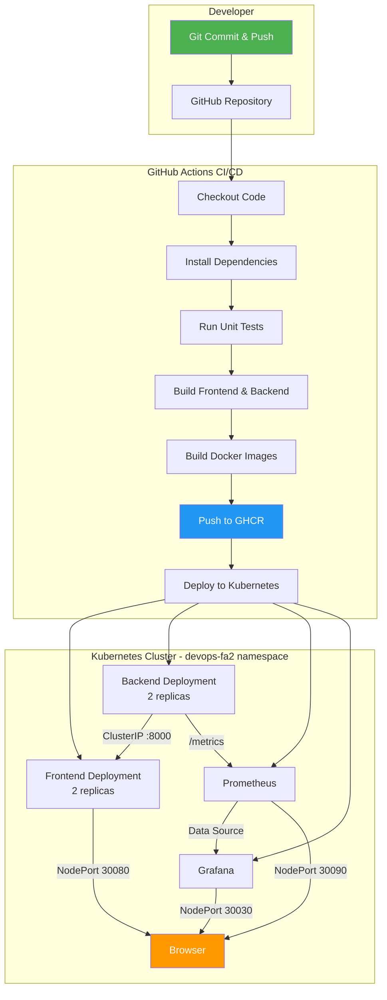

# 🚀 DevOps Environment Manager — FA1 + FA2

> **Student:** Vijay Dhame  
> **GitHub:** [github.com/Vijay-Dhame](https://github.com/Vijay-Dhame)  
> **Repository:** [github.com/Vijay-Dhame/FA1](https://github.com/Vijay-Dhame/FA1)

---

## 📋 Table of Contents

1. [Project Overview](#project-overview)
2. [FA1 — Multi-Environment Container Deployment](#fa1--multi-environment-container-deployment)
3. [FA2 — CI/CD, Container Orchestration & Observability](#fa2--cicd-container-orchestration--observability)
4. [Architecture Diagram](#architecture-diagram)
5. [Technology Stack](#technology-stack)
6. [Project Directory Structure](#project-directory-structure)
7. [Prerequisites](#prerequisites)
8. [Quick Start — FA1 (Docker + Terraform)](#quick-start--fa1-docker--terraform)
9. [Quick Start — FA2 (Kubernetes + Monitoring)](#quick-start--fa2-kubernetes--monitoring)
10. [GitHub Actions CI/CD Pipeline](#github-actions-cicd-pipeline)
11. [GHCR Configuration](#ghcr-configuration)
12. [Kubernetes Deployment](#kubernetes-deployment)
13. [Self-Hosted Runner Setup](#self-hosted-runner-setup)
14. [Prometheus Metrics](#prometheus-metrics)
15. [Grafana Dashboard](#grafana-dashboard)
16. [Unit Tests](#unit-tests)
17. [Scaling, Rollout & Rollback](#scaling-rollout--rollback)
18. [Troubleshooting](#troubleshooting)
19. [Assessment Checklist (19 Criteria)](#assessment-checklist-19-criteria)
20. [Practical Demonstration Script](#practical-demonstration-script)
21. [Viva Questions & Answers](#viva-questions--answers)

---

## Project Overview

**DevOps Environment Manager** is an academic demonstration application consisting of:
- A **React + TypeScript + Vite** frontend dashboard
- A **Python + FastAPI** backend API

The application was built to demonstrate:
- **FA1:** Terraform-managed multi-environment Docker deployments (QA, UAT, PROD)
- **FA2:** CI/CD pipelines, Kubernetes orchestration, and Prometheus/Grafana observability

---

## FA1 — Multi-Environment Container Deployment

FA1 demonstrates deploying the same application across **three isolated environments** (QA, UAT, PROD) using Docker containers managed by Terraform with workspace-based state isolation.

| Environment | Frontend Port | Backend Port |
|-------------|--------------|-------------|
| QA          | 8081         | 8001        |
| UAT         | 8082         | 8002        |
| PROD        | 8083         | 8003        |

### FA1 Key Files
- `terraform/` — Terraform configuration with per-environment `.tfvars`
- `deploy.ps1` — PowerShell script to deploy any environment
- `destroy.ps1` — PowerShell script to tear down an environment
- `docker-compose.yml` — Local development convenience

---

## FA2 — CI/CD, Container Orchestration & Observability

FA2 extends the FA1 application with:

1. **GitHub Actions CI/CD** — Automated build, test, Docker publish, and Kubernetes deploy
2. **GHCR (GitHub Container Registry)** — Docker images published with Git SHA tags
3. **Kubernetes Deployment** — Frontend + Backend running as Pods with Services
4. **Prometheus** — Collects HTTP request metrics from the backend `/metrics` endpoint
5. **Grafana** — Dashboard with 6 panels visualizing application metrics

---

## Architecture Diagram



---

## Technology Stack

| Layer         | Technology                                      |
|---------------|------------------------------------------------|
| Frontend      | React 18, TypeScript, Vite 6                   |
| Backend       | Python 3.11, FastAPI 0.115.6, Uvicorn          |
| Metrics       | prometheus-fastapi-instrumentator 6.1.0         |
| Containers    | Docker, multi-stage builds                      |
| Registry      | GitHub Container Registry (GHCR)                |
| IaC (FA1)     | Terraform with Docker provider                  |
| Orchestration | Kubernetes (Docker Desktop)                     |
| CI/CD         | GitHub Actions (self-hosted runner)              |
| Monitoring    | Prometheus 2.51, Grafana 10.4                   |

---

## Project Directory Structure

```
fa1-devops-environment-manager/
├── .github/
│   └── workflows/
│       └── ci-cd.yml              # GitHub Actions CI/CD pipeline
├── backend/
│   ├── app/
│   │   ├── __init__.py
│   │   └── main.py                # FastAPI app with /metrics endpoint
│   ├── tests/
│   │   ├── test_main.py           # 14 backend unit tests
│   │   └── test_metrics.py        # Prometheus /metrics test
│   ├── Dockerfile                 # Python backend image
│   ├── requirements.txt           # Python dependencies
│   └── .dockerignore
├── frontend/
│   ├── src/
│   │   ├── App.tsx                # Main React component
│   │   ├── api.ts                 # Backend API helpers
│   │   ├── components/
│   │   │   └── EnvironmentCard.tsx
│   │   ├── main.tsx
│   │   └── styles.css
│   ├── Dockerfile                 # Multi-stage Node + Nginx image
│   ├── nginx.conf                 # Nginx config (Docker/Terraform)
│   ├── nginx-k8s.conf             # Nginx config with reverse proxy (K8s)
│   ├── package.json
│   └── .dockerignore
├── k8s/
│   ├── namespace.yaml             # devops-fa2 namespace
│   ├── configmap.yaml             # App environment variables
│   ├── backend-deployment.yaml    # Backend Deployment (2 replicas)
│   ├── backend-service.yaml       # Backend ClusterIP Service
│   ├── frontend-deployment.yaml   # Frontend Deployment (2 replicas)
│   ├── frontend-service.yaml      # Frontend NodePort Service (:30080)
│   └── monitoring/
│       ├── prometheus-config.yaml
│       ├── prometheus-deployment.yaml
│       ├── prometheus-service.yaml    # NodePort :30090
│       ├── grafana-deployment.yaml
│       ├── grafana-service.yaml       # NodePort :30030
│       ├── grafana-dashboard-configmap.yaml
│       └── grafana-provisioning/
│           ├── datasource.yaml
│           ├── dashboard-provider.yaml
│           └── dashboard.json
├── terraform/
│   ├── main.tf
│   ├── variables.tf
│   ├── outputs.tf
│   ├── providers.tf
│   ├── versions.tf
│   └── environments/
│       ├── qa.tfvars
│       ├── uat.tfvars
│       └── prod.tfvars
├── deploy.ps1                     # FA1: Deploy environment via Terraform
├── destroy.ps1                    # FA1: Destroy environment via Terraform
├── deploy-k8s.ps1                 # FA2: Deploy to local Kubernetes
├── docker-compose.yml             # Local dev convenience
├── .gitignore
├── .dockerignore
└── README.md
```

---

## Prerequisites

| Tool             | Required Version | Check Command              |
|------------------|-----------------|---------------------------|
| Windows 11       | —               | `winver`                   |
| Docker Desktop   | ≥ 4.x           | `docker --version`         |
| Kubernetes       | Enabled in DD   | `kubectl cluster-info`     |
| Git              | ≥ 2.x           | `git --version`            |
| Python           | 3.11+           | `python --version`         |
| Node.js          | 20+             | `node --version`           |
| Terraform (FA1)  | ≥ 1.5           | `terraform --version`      |

### Enable Kubernetes in Docker Desktop
1. Open **Docker Desktop → Settings → Kubernetes**
2. Check **Enable Kubernetes**
3. Click **Apply & Restart**
4. Verify: `kubectl cluster-info`

---

## Quick Start — FA1 (Docker + Terraform)

```powershell
# Build Docker images
docker build -t devops-em-frontend:latest ./frontend
docker build -t devops-em-backend:latest  ./backend

# Deploy QA environment via Terraform
.\deploy.ps1 -Environment qa

# Deploy UAT environment
.\deploy.ps1 -Environment uat

# Deploy PROD environment
.\deploy.ps1 -Environment prod

# Verify
curl http://localhost:8001/health   # QA backend
curl http://localhost:8002/health   # UAT backend
curl http://localhost:8003/health   # PROD backend
```

---

## Quick Start — FA2 (Kubernetes + Monitoring)

```powershell
# One-command deploy to local Kubernetes
.\deploy-k8s.ps1

# Or manually:
kubectl apply -f k8s/namespace.yaml
kubectl apply -f k8s/configmap.yaml
kubectl apply -f k8s/backend-deployment.yaml
kubectl apply -f k8s/backend-service.yaml
kubectl apply -f k8s/frontend-deployment.yaml
kubectl apply -f k8s/frontend-service.yaml
kubectl apply -f k8s/monitoring/

# Verify
kubectl get all -n devops-fa2
curl http://localhost:30080          # Frontend
curl http://localhost:30080/health   # Backend via reverse proxy
curl http://localhost:30090          # Prometheus
# Grafana: http://localhost:30030    (admin/admin)
```

---

## GitHub Actions CI/CD Pipeline

The pipeline is defined in `.github/workflows/ci-cd.yml` and runs on a **self-hosted runner**.

### Pipeline Flow

```
Push to main
  │
  ├─► Job 1: Build & Test
  │     ├── Checkout code
  │     ├── Install Python deps
  │     ├── Run pytest (15 backend tests)
  │     ├── Install Node deps
  │     └── Build frontend (tsc + vite build)
  │
  ├─► Job 2: Docker Build & Publish (needs: test)
  │     ├── Login to GHCR
  │     ├── Build backend image (SHA + latest tags)
  │     ├── Build frontend image (SHA + latest tags)
  │     └── Push both images to GHCR
  │
  └─► Job 3: Deploy to Kubernetes (needs: docker-publish)
        ├── Verify cluster connectivity
        ├── Apply namespace, configmaps, deployments, services
        ├── Deploy monitoring stack
        └── Verify rollout status
```

### Pipeline Failure Behavior
- ❌ Test failure → Docker build **skipped**
- ❌ Docker build failure → Kubernetes deploy **skipped**
- ❌ Rollout timeout → Pipeline **fails**
- ✅ Pull requests → Only run tests (no deploy)

---

## GHCR Configuration

### Image Names
```
ghcr.io/vijay-dhame/fa1-backend:<git-sha>
ghcr.io/vijay-dhame/fa1-backend:latest
ghcr.io/vijay-dhame/fa1-frontend:<git-sha>
ghcr.io/vijay-dhame/fa1-frontend:latest
```

### Required GitHub Settings
1. **Repository Settings → Actions → General:**
   - Workflow permissions: **Read and write permissions**
2. The `GITHUB_TOKEN` is used automatically for GHCR auth — no extra secrets needed.
3. After first publish, go to **Packages → Package Settings → Manage Actions access** and add the repository.

### Making Images Public (Optional)
1. Go to `github.com/Vijay-Dhame` → **Packages**
2. Click each package → **Package settings** → **Change visibility** → **Public**
3. This avoids needing `imagePullSecret` in Kubernetes.

---

## Kubernetes Deployment

### Namespace
All FA2 resources are deployed to the `devops-fa2` namespace, keeping them separate from FA1 Docker/Terraform environments.

### Networking Design
- **Backend Service:** ClusterIP (internal only, port 8000)
- **Frontend Service:** NodePort 30080 (browser-accessible)
- **Frontend Nginx** includes a reverse proxy (`/api/` → backend:8000) so the browser never needs to reach the backend directly
- **Prometheus:** NodePort 30090
- **Grafana:** NodePort 30030

### Access URLs (Docker Desktop)
| Service    | URL                        |
|-----------|---------------------------|
| Frontend  | http://localhost:30080      |
| Backend   | http://localhost:30080/health (via nginx proxy) |
| Prometheus| http://localhost:30090      |
| Grafana   | http://localhost:30030 (admin/admin) |

---

## Self-Hosted Runner Setup

Since the Kubernetes cluster runs locally on Docker Desktop, a **self-hosted GitHub Actions runner** is needed for deployment.

### Setup Steps
```powershell
# 1. Go to GitHub → Repository → Settings → Actions → Runners → New self-hosted runner

# 2. Download and configure (follow GitHub's instructions):
mkdir C:\actions-runner; cd C:\actions-runner
# Download the runner package from GitHub
# Extract and run:
.\config.cmd --url https://github.com/Vijay-Dhame/FA1 --token <RUNNER_TOKEN>

# 3. Start the runner
.\run.cmd

# 4. Verify Docker and kubectl are available to the runner:
docker --version
kubectl cluster-info
```

### Generate Runner Token
```powershell
.\generate_runner_token.ps1
```

---

## Prometheus Metrics

### Backend Instrumentation
The backend uses `prometheus-fastapi-instrumentator` to automatically expose metrics at `/metrics`.

### Metrics Available
| Metric                             | Type      | Description                   |
|------------------------------------|----------|-------------------------------|
| `http_requests_total`              | Counter  | Total HTTP requests           |
| `http_request_duration_seconds`    | Histogram| Request latency distribution  |
| `http_requests_in_progress`        | Gauge    | Currently active requests     |
| `up`                               | Gauge    | Target health (1=UP, 0=DOWN)  |

### Verify Metrics
```powershell
# Direct from backend pod
kubectl port-forward svc/backend 8000:8000 -n devops-fa2
curl http://localhost:8000/metrics

# From Prometheus UI
# Navigate to http://localhost:30090 → Status → Targets
# The "devops-backend" target should show as UP
```

### Generate Test Traffic
```powershell
# Hit the backend endpoints to generate metrics
for ($i=0; $i -lt 50; $i++) {
    Invoke-WebRequest -Uri http://localhost:30080/health -UseBasicParsing | Out-Null
    Invoke-WebRequest -Uri http://localhost:30080/api/info -UseBasicParsing | Out-Null
    Invoke-WebRequest -Uri http://localhost:30080/api/status -UseBasicParsing | Out-Null
}
```

---

## Grafana Dashboard

### Access
- **URL:** http://localhost:30030
- **Username:** admin
- **Password:** admin

### Dashboard: "DevOps Environment Manager — FA2"
The dashboard is **auto-provisioned** via ConfigMaps and contains **6 panels**:

| # | Panel                        | Type       | PromQL                                                                       |
|---|------------------------------|-----------|-----------------------------------------------------------------------------|
| 1 | Total HTTP Requests          | Stat      | `sum(http_requests_total{job="devops-backend"})`                            |
| 2 | HTTP Request Rate            | Timeseries| `rate(http_requests_total{job="devops-backend"}[1m])`                       |
| 3 | Response Latency (p50/p95/p99)| Timeseries| `histogram_quantile(0.95, ...http_request_duration_seconds_bucket...)`      |
| 4 | Prometheus Target Health     | Stat      | `up{job="devops-backend"}`                                                  |
| 5 | Requests by Status Code      | Pie Chart | `sum by (status) (http_requests_total{job="devops-backend"})`               |
| 6 | Requests In-Progress         | Gauge     | `sum(http_requests_in_progress{job="devops-backend"})`                      |

---

## Unit Tests

### Backend Tests (15 tests)
```powershell
# Run from project root
python -m pytest backend/tests/ -v
```

| Test                                    | Endpoint     | Assertion                        |
|-----------------------------------------|-------------|----------------------------------|
| test_root_returns_200                   | GET /        | Status 200                       |
| test_root_contains_application_name     | GET /        | application == "DevOps Env Mgr"  |
| test_root_contains_version              | GET /        | version == "1.0.0"               |
| test_health_returns_200                 | GET /health  | Status 200                       |
| test_health_status_is_healthy           | GET /health  | status == "healthy"              |
| test_health_has_timestamp               | GET /health  | timestamp field present          |
| test_info_returns_200                   | GET /api/info| Status 200                       |
| test_info_contains_required_fields      | GET /api/info| All required fields present      |
| test_status_returns_200                 | GET /api/status| Status 200                     |
| test_status_shows_running               | GET /api/status| status == "running"            |
| test_default_environment_is_development | GET /api/info| environment is non-empty string  |
| test_environment_matches_across_endpoints| Multiple   | Environment consistent           |
| test_nonexistent_route_returns_404      | GET /api/x   | Status 404                       |
| test_post_to_health_returns_405         | POST /health | Status 405                       |
| test_metrics_endpoint                   | GET /metrics | Status 200, contains "# HELP"   |

### Frontend Build Check
```powershell
cd frontend
npm ci
npm run build   # Fails if TypeScript errors exist
```

---

## Scaling, Rollout & Rollback

```powershell
# Scale backend to 4 replicas
kubectl scale deployment backend --replicas=4 -n devops-fa2

# Verify scaling
kubectl get pods -n devops-fa2 -l app=backend

# Check rollout status
kubectl rollout status deployment/backend -n devops-fa2

# View rollout history
kubectl rollout history deployment/backend -n devops-fa2

# Rolling update (change image tag)
kubectl set image deployment/backend backend=ghcr.io/vijay-dhame/fa1-backend:<new-sha> -n devops-fa2

# Rollback to previous version
kubectl rollout undo deployment/backend -n devops-fa2

# Verify rollback
kubectl rollout status deployment/backend -n devops-fa2
```

---

## Troubleshooting

| Problem                              | Solution                                                              |
|--------------------------------------|----------------------------------------------------------------------|
| Kubernetes not reachable             | Enable Kubernetes in Docker Desktop Settings                          |
| `kubectl` context not set            | `kubectl config use-context docker-desktop`                           |
| Images not pulling from GHCR         | Set `imagePullPolicy: IfNotPresent` or make packages public           |
| Frontend can't reach backend         | Check nginx-k8s.conf reverse proxy and backend service name           |
| Prometheus target DOWN               | Verify backend pod is running: `kubectl get pods -n devops-fa2`       |
| Grafana shows "No data"              | Generate traffic first, check Prometheus data source connection       |
| Self-hosted runner offline           | Start runner: `cd C:\actions-runner; .\run.cmd`                       |
| Port already in use (30080)          | `kubectl delete svc frontend -n devops-fa2` and re-apply              |
| Tests fail in CI                     | Run locally first: `python -m pytest backend/tests/ -v`               |

---

## Assessment Checklist (19 Criteria)

| #  | Criterion                                        | Evidence                                   | Status     |
|----|--------------------------------------------------|--------------------------------------------|------------|
| 1  | Git repository and source code maintained        | GitHub repo with commit history            | ✅ Verified |
| 2  | Pipeline triggered by Git push                   | `on: push` in ci-cd.yml                    | ✅ Verified |
| 3  | CI/CD tool configured                            | GitHub Actions + self-hosted runner        | ✅ Verified |
| 4  | Pipeline performs checkout and build              | `actions/checkout@v4` + `npm run build`    | ✅ Verified |
| 5  | Pipeline performs automated testing               | `pytest` in Job 1                          | ✅ Verified |
| 6  | Docker image built automatically                 | Job 2: `docker build` both images          | ✅ Verified |
| 7  | Pipeline completes end-to-end                    | 3-job pipeline with dependencies           | ✅ Verified |
| 8  | Application builds successfully                  | Frontend tsc+vite, Backend pip install     | ✅ Verified |
| 9  | At least one unit test executes                  | 15 pytest tests passing                    | ✅ Verified |
| 10 | Pipeline fails on test/build failure             | `needs: test` prevents deployment          | ✅ Verified |
| 11 | Docker image and tag generated correctly         | SHA tags + latest published to GHCR        | ✅ Verified |
| 12 | Container/application deployed                   | K8s deployment via self-hosted runner      | ✅ Verified |
| 13 | Kubernetes Deployment configuration              | `k8s/backend-deployment.yaml` etc.        | ✅ Verified |
| 14 | Kubernetes Service configuration                 | NodePort + ClusterIP services             | ✅ Verified |
| 15 | Application runs as Kubernetes Pods              | 2 replicas each, health probes            | ✅ Verified |
| 16 | Scaling, rollout, deployment status              | `kubectl scale`, `rollout status`         | ✅ Verified |
| 17 | Prometheus configured and collecting             | Scrapes backend /metrics, target UP       | ✅ Verified |
| 18 | Grafana dashboard created                        | Auto-provisioned with 6 panels            | ✅ Verified |
| 19 | ≥2 meaningful metrics visualized                 | Request count, rate, latency, health, etc.| ✅ Verified |

---

## Practical Demonstration Script

### Step-by-step Commands

```powershell
# 1. Show repository structure
Get-ChildItem -Recurse -Depth 2 | Select-Object Name, PSIsContainer

# 2. Run unit tests
python -m pytest backend/tests/ -v

# 3. Build Docker images
docker build -t ghcr.io/vijay-dhame/fa1-backend:demo  ./backend
docker build -t ghcr.io/vijay-dhame/fa1-frontend:demo ./frontend

# 4. Show existing FA1 Terraform config
Get-Content terraform/main.tf

# 5. Deploy to Kubernetes
.\deploy-k8s.ps1

# 6. Verify pods
kubectl get pods -n devops-fa2

# 7. Verify services
kubectl get svc -n devops-fa2

# 8. Check application health
curl http://localhost:30080/health

# 9. Show Prometheus targets
# Open http://localhost:30090/targets in browser

# 10. Show Grafana dashboard
# Open http://localhost:30030 → Login admin/admin → Dashboard

# 11. Generate traffic and observe metrics
for ($i=0; $i -lt 20; $i++) {
    Invoke-WebRequest http://localhost:30080/api/status -UseBasicParsing | Out-Null
}

# 12. Scale deployment
kubectl scale deployment backend --replicas=4 -n devops-fa2
kubectl get pods -n devops-fa2 -l app=backend

# 13. Demonstrate rollout
kubectl rollout status deployment/backend -n devops-fa2
kubectl rollout history deployment/backend -n devops-fa2

# 14. Git push triggers pipeline
git add .
git commit -m "FA2: CI/CD, Kubernetes, Monitoring"
git push origin main
# Show GitHub Actions → workflow run

# 15. Demonstrate test failure stops pipeline
# Edit a test to fail → push → show failed pipeline → revert
```

### Two-Minute Explanation

> "This is the DevOps Environment Manager, a full-stack application with a React frontend and FastAPI backend. For FA1, I used Terraform to deploy it across three Docker environments: QA, UAT, and PROD, each with isolated state.
>
> For FA2, I extended it with a complete CI/CD pipeline using GitHub Actions. When I push code to GitHub, the pipeline automatically checks out the code, installs dependencies, runs 15 unit tests, and builds the frontend. If all tests pass, it builds Docker images tagged with the Git commit SHA and pushes them to GitHub Container Registry.
>
> The final step deploys to Kubernetes using a self-hosted runner on my local machine. The app runs in a dedicated namespace with 2 replicas each for frontend and backend, with health probes and rolling update strategies.
>
> For observability, the backend exposes Prometheus metrics at /metrics, tracking HTTP request counts, latency distributions, and in-progress requests. Prometheus scrapes these every 10 seconds, and Grafana displays them on an auto-provisioned dashboard with 6 panels including request rate, latency percentiles, and target health status.
>
> If a test fails, the pipeline stops — no broken code gets deployed. I can also scale pods, perform rolling updates, and rollback using kubectl commands."

---

## Viva Questions & Answers

### CI/CD

**Q1: What is CI/CD?**  
CI (Continuous Integration) automatically builds and tests code on every commit. CD (Continuous Deployment/Delivery) automatically deploys tested code to environments.

**Q2: What CI/CD tool did you use?**  
GitHub Actions with a self-hosted runner for local Kubernetes deployment.

**Q3: How does the pipeline prevent deploying broken code?**  
The pipeline has 3 jobs with `needs` dependencies. If tests fail in Job 1, Jobs 2 (Docker) and 3 (Deploy) are skipped.

**Q4: What triggers the pipeline?**  
Push to `main` branch or pull requests to `main`. Only pushes deploy; PRs only run tests.

**Q5: What is a self-hosted runner?**  
A machine you manage that runs GitHub Actions jobs. Needed here because the Kubernetes cluster is local.

### Docker & GHCR

**Q6: Why use multi-stage Docker builds?**  
The frontend Dockerfile uses Node to build, then copies only the built assets to a slim Nginx image, reducing the final image size.

**Q7: What is GHCR?**  
GitHub Container Registry — a Docker image registry built into GitHub, authenticated via GITHUB_TOKEN.

**Q8: Why use Git SHA tags instead of "latest"?**  
SHA tags are immutable and traceable. You know exactly which commit produced each image.

**Q9: What is a .dockerignore file?**  
It excludes files from the Docker build context, preventing unnecessary files (node_modules, .git) from being copied into images.

**Q10: How do you authenticate to GHCR in CI?**  
Using the `GITHUB_TOKEN` secret provided automatically by GitHub Actions.

### Kubernetes

**Q11: What is a Kubernetes Deployment?**  
A resource that manages a set of identical pods, handling scaling, rolling updates, and self-healing.

**Q12: What is a Kubernetes Service?**  
An abstraction that provides a stable network endpoint for accessing pods, even as pods are created/destroyed.

**Q13: What is the difference between ClusterIP and NodePort?**  
ClusterIP is internal-only. NodePort exposes the service on a port on every node, making it accessible from outside the cluster.

**Q14: How does the frontend reach the backend in Kubernetes?**  
Nginx in the frontend pod has a reverse proxy that forwards `/api/` requests to the backend ClusterIP service using Kubernetes DNS.

**Q15: What are readiness and liveness probes?**  
Readiness probes determine if a pod can receive traffic. Liveness probes determine if a pod should be restarted.

**Q16: How do you scale a deployment?**  
`kubectl scale deployment backend --replicas=4 -n devops-fa2`

**Q17: How do you rollback a deployment?**  
`kubectl rollout undo deployment/backend -n devops-fa2`

**Q18: What is a Kubernetes namespace?**  
A logical partition within a cluster. We use `devops-fa2` to isolate FA2 resources.

**Q19: What is a ConfigMap?**  
A Kubernetes resource for storing non-sensitive configuration data that can be injected into pods as environment variables.

### Prometheus & Grafana

**Q20: What is Prometheus?**  
An open-source monitoring system that collects metrics by scraping HTTP endpoints at regular intervals.

**Q21: What metrics does your backend expose?**  
HTTP request count, request duration (latency histogram), and in-progress requests via the `/metrics` endpoint.

**Q22: What is PromQL?**  
Prometheus Query Language — used to query metrics. Example: `rate(http_requests_total[1m])` gives requests per second.

**Q23: What is Grafana?**  
A visualization platform that connects to data sources like Prometheus and displays metrics in dashboards.

**Q24: How many dashboard panels do you have?**  
Six: Total Requests, Request Rate, Latency Percentiles, Target Health, Status Code Distribution, and In-Progress Requests.

**Q25: How is the Grafana dashboard provisioned?**  
Via ConfigMaps that contain the datasource config, dashboard provider config, and dashboard JSON, mounted into the Grafana pod.

---

## Screenshot Checklist

- [ ] GitHub repository with all files
- [ ] GitHub Actions workflow run (successful)
- [ ] GitHub Actions workflow run (failed test)
- [ ] GHCR packages page showing images
- [ ] `kubectl get all -n devops-fa2` output
- [ ] Frontend running at localhost:30080
- [ ] Backend health response
- [ ] Prometheus targets page (target UP)
- [ ] Prometheus graph with a query
- [ ] Grafana dashboard with all 6 panels
- [ ] `kubectl scale` command output
- [ ] `kubectl rollout status` output
- [ ] Terminal showing 15 tests passing

---

*Built by Vijay Dhame — DevOps Environment Manager FA1 + FA2*
